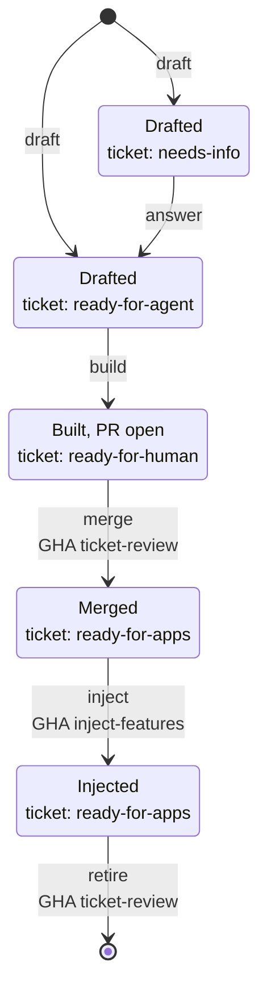

# Feature Workflow

Status: draft. Tracked in [#90](https://github.com/any-container/rails-template/issues/90).

## Lifecycle

A feature moves from a draft to a feature injected in the template apps: draft, build, verify, inject, clean up.

Every draft has a GitHub ticket, linked on the draft's `Ticket:` line. Each state below is a feature state and a ticket label.

| Verb | What it does |
|------|--------------|
| `draft` | A human writes the draft and opens its ticket; it starts at `needs-info` if the draft has open questions, otherwise `ready-for-agent`. |
| `answer` | A human resolves the draft's open questions and relabels the ticket `ready-for-agent`. |
| `build` | The daily agent builds the feature with `new-feature`, opens a PR with `Refs #n`, and relabels the ticket `ready-for-human`. |
| `merge` | A human merges the PR, and the ticket review workflow relabels the ticket `ready-for-apps`. |
| `inject` | The feature is applied to every `rails-api/` app in dependency order, in a PR that CI verifies. |
| `retire` | The ticket review workflow's PR deletes the draft and closes the ticket. |

## Daily build

A scheduled task on the Claude account runs every day at 10:43 UTC. It:
1. Lists open issues labelled `ready-for-agent` and picks the oldest.
2. Runs the `new-feature` skill with the ticket's draft as input.
3. Opens a PR whose description says `Refs #n`. It uses `Refs`, not `Closes`, so the ticket stays open until the draft is removed.
4. Changes the ticket from `ready-for-agent` to `ready-for-human`.

If nothing is labelled `ready-for-agent`, it stops. If verification fails, it opens a draft PR describing the failure and leaves the label unchanged.

## Ticket review workflow

`.github/workflows/ticket-review.yml`. Runs daily, on demand, and when a PR to `main` is merged.

| Job | Action |
|-----|--------|
| `promote-tickets` | A ticket labelled `ready-for-human` whose number appears in the description of a merged PR moves to `ready-for-apps`. |
| `find-injected-drafts` | A draft counts as injected when `features/<name>/` exists and every `rails-api/<variant>/<minor>-latest` app holds `features/<name>.md`. |
| `remove-injected-drafts` | Opens a PR deleting each injected draft, with `Closes #n` taken from the draft's `Ticket:` line. Merging the PR closes the ticket. |

Requires the `ready-for-apps` label (the workflow creates it if absent) and the `APP_ID` / `APP_PRIVATE_KEY` credentials that `fresh-api-app.yml` already uses, so the PRs it opens trigger CI.

## Injection

A `ready-for-apps` ticket means the feature is merged and tested on its own, and is waiting to be applied to the template apps. `.github/workflows/inject-features.yml` does it:

1. Target apps: every `rails-api/<variant>/<minor>-latest` folder. Variants today: `postgres-rspec`, `or-rspec`.
2. Order: `.github/scripts/feature_order.rb` puts `feature_registry` first, then each feature after the features in its `depends_on` front matter (`files/features/<name>.md`).
3. Per app: `bin/rails app:template LOCATION=features/<name>/template.rb` for each feature in order. Templates are idempotent, so features already present change nothing. A template that hits a conflicting host file fails rather than overwriting it.
4. The workflow opens a PR with the result and `Refs #n` for each `ready-for-apps` ticket. CI verifies it.
5. After the merge, each app holds `features/<name>.md`. That file is what the ticket review workflow reads to decide a draft is injected.

It runs daily after the ticket review workflow, on demand, and as a callable workflow.

Not yet wired: `fresh-api-app.yml` deletes and regenerates `rails-api/<variant>/<minor>-latest` on each new Rails patch release, which removes every injected feature. It must call `inject-features.yml` after regenerating. Also not yet wired: `db/schema.rb` and annotations for `postgres-rspec` after injection (`active_record_schema_and_annotations.yml`).

## Verification

Verification is done by the CI workflow that runs the tests on any PR that changes a template. It is not a manual step. For a feature PR it must:
- apply the feature to a copy of each template app;
- run `bin/rails db:migrate` and `bundle exec rspec`;
- apply `template.rb` a second time and confirm nothing changes.

For an injection PR it runs the app's own test suite.

`.github/workflows/test.yml` is currently a stub (manual trigger, prints a date). It must be implemented and triggered on `pull_request` for `features/**` and `rails-api/**`. A failing run returns the work to Build or Inject.

## Open items

- Implement `test.yml`.
- Call `inject-features.yml` from `fresh-api-app.yml`, and run the schema and annotations workflow after injection.
