# Feature Workflow

Status: draft. Tracked in [#90](https://github.com/any-container/rails-template/issues/90).

## Lifecycle

A feature moves from a draft to a feature injected in the template apps: draft, build, verify, inject, clean up.

Every draft has a GitHub ticket, linked on the draft's `Ticket:` line. The ticket's label says who acts next.

```mermaid
flowchart TD
    Draft["Draft + ticket<br/>features/drafts/&lt;feature_name&gt;.md<br/>Ticket: #n"] --> Open{"Open questions<br/>in the draft?"}
    Open -->|yes| NeedsInfo["needs-info"]
    NeedsInfo -->|answered in draft| ReadyAgent
    Open -->|no| ReadyAgent["ready-for-agent"]

    ReadyAgent --> Daily["Daily scheduled agent<br/>picks the oldest ready-for-agent ticket"]

    subgraph Build["Build (new-feature skill)"]
        direction TB
        B1["Check features/CONTEXT.md for overlap"] --> B2["Create features/&lt;feature_name&gt;/<br/>FEATURE.md, template.rb, files/"]
        B2 --> B3["Write code and RSpec specs in files/"]
        B3 --> B4["Write registry description<br/>files/features/&lt;feature_name&gt;.md"]
        B4 --> B5["Add row to features/CONTEXT.md"]
    end

    Daily --> Build
    Build --> PR["Pull request<br/>description: Refs #n"]
    PR --> ReadyHuman["ready-for-human<br/>(set by the agent after the PR exists)"]

    PR --> CI{"CI: tests run on PRs<br/>that change templates"}
    CI -->|fail| Build
    CI -->|pass| Review["Human reviews and merges"]
    ReadyHuman --> Review

    Review --> TR1["Ticket review workflow<br/>PR with Refs #n is merged"]
    TR1 --> ReadyApps["ready-for-apps"]
    ReadyApps --> Inject["Inject into every rails-api/ template app<br/>in dependency order"]
    Inject --> PR2["Pull request with the injected apps"]
    PR2 --> CI2{"CI: tests run on PRs<br/>that change templates"}
    CI2 -->|fail| Inject
    CI2 -->|pass| Merge2["Human merges"]

    Merge2 --> TR2["Ticket review workflow<br/>finds draft already injected"]
    TR2 --> PR3["Pull request deleting the draft<br/>Closes #n"]
    PR3 --> Done(["Draft removed, ticket closed"])
```

## Stages

| Stage | Who | Input | Output | Gate to move on |
|-------|-----|-------|--------|-----------------|
| Draft | Human | Feature idea | `features/drafts/<feature_name>.md` with a `Ticket:` line; the ticket | Ticket exists, is named in the draft, and carries the right label (below). |
| Build | Daily agent, `new-feature` skill | Oldest `ready-for-agent` ticket and its draft | `features/<feature_name>/` with `FEATURE.md`, `template.rb`, `files/`; a PR with `Refs #n` in the description | `FEATURE.md` complete; CONTEXT.md row added. Then the agent moves the ticket to `ready-for-human`. |
| Verify | CI | The PR | Pass or fail | See [Verification](#verification). |
| Inject | Proposed workflow | `ready-for-apps` ticket | A PR with the feature applied to the template apps | See [Injection](#injection). |
| Clean up | Ticket review workflow | Draft whose feature is in every app | A PR deleting the draft, with `Closes #n` | Merge closes the ticket. |

## Daily build

A scheduled task on the Claude account runs every day at 10:43 UTC. It:
1. Lists open issues labelled `ready-for-agent` and picks the oldest.
2. Runs the `new-feature` skill with the ticket's draft as input.
3. Opens a PR whose description says `Refs #n`. It uses `Refs`, not `Closes`, so the ticket stays open until the draft is removed.
4. Changes the ticket from `ready-for-agent` to `ready-for-human`.

If nothing is labelled `ready-for-agent`, it stops. If verification fails, it opens a draft PR describing the failure and leaves the label unchanged.

## Ticket review workflow

`.github/workflows/ticket-review.yml`. Runs daily, on demand, and when a PR to `main` is merged.

| Job | Action |
|-----|--------|
| `promote-tickets` | A ticket labelled `ready-for-human` whose number appears in the description of a merged PR moves to `ready-for-apps`. |
| `find-injected-drafts` | A draft counts as injected when `features/<name>/` exists and every `rails-api/<variant>/<minor>-latest` app holds `features/<name>.md`. |
| `remove-injected-drafts` | Opens a PR deleting each injected draft, with `Closes #n` taken from the draft's `Ticket:` line. Merging the PR closes the ticket. |

Requires the `ready-for-apps` label (the workflow creates it if absent) and the `APP_ID` / `APP_PRIVATE_KEY` credentials that `fresh-api-app.yml` already uses, so the PRs it opens trigger CI.

## Injection

A `ready-for-apps` ticket means the feature is merged and tested on its own, and is waiting to be applied to the template apps. Proposed process, not yet built:

1. Target apps: every `rails-api/<variant>/<minor>-latest` folder. Variants today: `postgres-rspec`, `or-rspec`.
2. Order: `feature_registry` first. Then each feature after the features in its `depends_on` front matter (`files/features/<name>.md`). Ticket order does not decide this.
3. Per app: run `bin/rails app:template LOCATION=features/<name>/template.rb`, then `bin/rails db:migrate`. The template is idempotent, so applying a feature already present changes nothing.
4. Commit the result to a branch and open a PR. CI verifies it.
5. After the merge, the app holds `features/<name>.md`. That file is what the ticket review workflow reads to decide the draft is injected.

Problem to resolve: `fresh-api-app.yml` deletes and regenerates `rails-api/<variant>/<minor>-latest` on each new Rails patch release. Regeneration would remove every injected feature. The injection step must run again after regeneration, or `fresh-api-app.yml` must apply all indexed features as part of generation.

## Verification

Verification is done by the CI workflow that runs the tests on any PR that changes a template. It is not a manual step. For a feature PR it must:
- apply the feature to a copy of each template app;
- run `bin/rails db:migrate` and `bundle exec rspec`;
- apply `template.rb` a second time and confirm nothing changes.

For an injection PR it runs the app's own test suite.

`.github/workflows/test.yml` is currently a stub (manual trigger, prints a date). It must be implemented and triggered on `pull_request` for `features/**` and `rails-api/**`. A failing run returns the work to Build or Inject.

## Open items

- Injection flow diagram, including dependency order (`feature_registry` first).
- Relationship diagram between `features/`, `rails-api/`, `.github/` workflows and `.claude/` skills.
- Implement the injection workflow and `test.yml`.
- Update `features/CONTEXT.md` and the `new-feature` skill to match this workflow.
