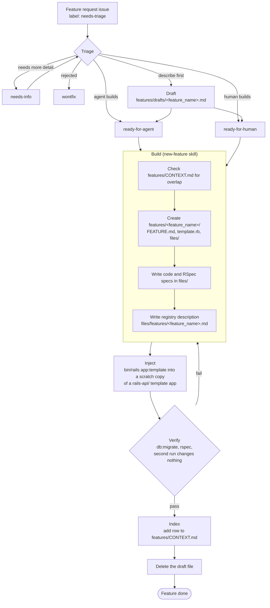

# Feature Workflow

Status: draft. Tracked in [#90](https://github.com/any-container/rails-template/issues/90).

## Lifecycle

A feature moves from a draft to an indexed feature in five stages: draft, build, inject, verify, index.

## Stages

| Stage | Input | Output | Gate to move on |
|-------|-------|--------|-----------------|
| Draft | Issue | `features/drafts/<feature_name>.md` | Issue labelled `ready-for-agent` or `ready-for-human`. |
| Build | Draft, `new-feature` skill | `features/<feature_name>/` with `FEATURE.md`, `template.rb`, `files/` | `FEATURE.md` complete. |
| Inject | `template.rb`, scratch copy of a `rails-api/` app | App with the feature applied | Template runs without error. |
| Verify | Injected app | Passing `db:migrate` and `rspec`; idempotent second run | All checks pass. A failure returns to Build. |
| Index | Verified feature | Row in `features/CONTEXT.md`; draft deleted | Row exists. |

## Open items

Remaining diagrams and sections from #90 are not yet drafted:
- Injection flow, including dependency order (`feature_registry` first).
- Relationships between `features/`, `rails-api/`, `.github/` workflows and `.claude/` skills.
- Per-variant verification (`postgres-rspec`, `or-rspec`).
- Feature validation in GitHub Actions.
